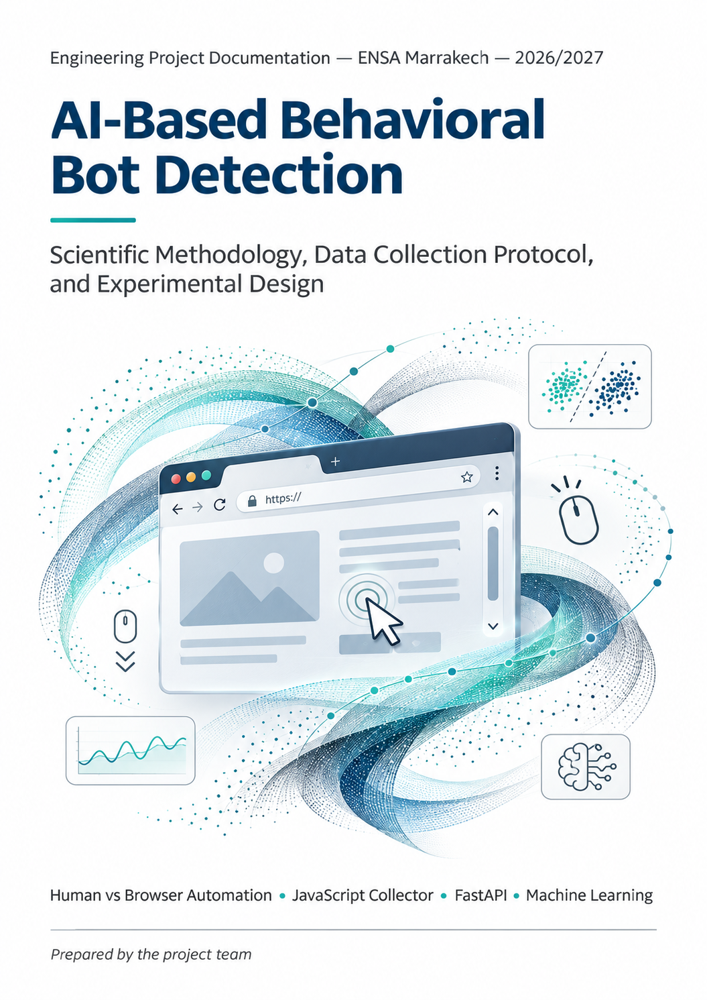

# Détection comportementale des bots web par IA



> **Nom du projet :** AI-Based Behavioral Bot Detection  
> **Équipe :** Imrane, Hiba, Saad, Chahd et Yahya  
> **Contexte :** projet universitaire d'intelligence artificielle  
> **Statut :** recherche, spécification et préparation du MVP

**Current MVP study:** [Scientific protocol for behavioral bot detection (English)](docs/SCIENTIFIC_PROTOCOL.md). The project overview below records the broader research roadmap.

[Code component guide (English)](docs/CODE_GUIDE.md) explains the modules, highlighted code examples, and their role in the experiment.

## 1. Présentation

Ce projet étudie l'utilisation de l'apprentissage automatique pour distinguer les sessions de navigation humaines des sessions automatisées sur un site web de test.

Le système analyse plusieurs familles de signaux :

- **Comportement du navigateur :** mouvements de souris, clics, défilement et intervalles de frappe.
- **Comportement des requêtes :** fréquence, séquence, durée et types de requêtes HTTP.
- **Contexte de session :** durée, pages visitées et séquences de navigation.

Le collecteur ne doit jamais enregistrer le texte saisi, les mots de passe ou le contenu des champs de formulaire. Pour le clavier, seules des mesures temporelles agrégées peuvent être étudiées.

Le système produit une estimation du caractère automatisé d'une session. Il ne détermine pas, à lui seul, si une action automatisée est malveillante. Certains bots sont légitimes.

## 2. Problème de recherche

**Question principale :**

> Dans quelle mesure des caractéristiques comportementales du navigateur et des caractéristiques de requêtes HTTP permettent-elles de distinguer des sessions humaines de sessions automatisées, y compris lorsque les bots utilisent des interactions de navigateur plus avancées ?

### Objectifs

1. Construire un site web contrôlé pour les expériences.
2. Collecter des sessions humaines avec consentement.
3. Générer des sessions automatisées de plusieurs niveaux.
4. Extraire des caractéristiques reproductibles.
5. Comparer plusieurs modèles de classification.
6. Mesurer les faux positifs, les faux négatifs et le délai de détection.
7. Présenter les résultats dans un tableau de bord.
8. Documenter les limites, les risques et les conditions de reproductibilité.

## 3. Périmètre du MVP

### Inclus

- Un site web de test développé par l'équipe.
- Un collecteur JavaScript d'événements de souris, de clic, de défilement et, si validé, de timing clavier sans contenu.
- Des caractéristiques agrégées côté navigateur.
- Des caractéristiques de requêtes calculées côté serveur.
- Une API FastAPI pour valider les données et demander une prédiction.
- Une chaîne de préparation des données et d'entraînement scikit-learn.
- Une comparaison initiale de Logistic Regression, Random Forest et HistGradientBoosting.
- Un tableau de bord Streamlit.
- Des tests avec des sessions humaines et des bots contrôlés.
- Une démonstration locale reproductible.

### Hors périmètre initial

- Un service commercial de protection anti-bot.
- Le blocage automatique de visiteurs réels.
- La détection certaine de l'intention malveillante.
- La collecte de données personnelles inutiles.
- Le fingerprinting invasif du navigateur.
- Une infrastructure distribuée ou des microservices.
- Une garantie de détection contre tous les bots modernes.

## 4. Catégories de sessions à étudier

| Catégorie | Description |
|---|---|
| Humain | Personne qui utilise le site manuellement |
| Bot simple | Script HTTP qui envoie des requêtes sans interaction normale dans le navigateur |
| Bot intermédiaire | Automatisation contrôlée d'un navigateur |
| Bot avancé | Automatisation avec timing et mouvements variés |

Les catégories décrivent le protocole expérimental. Elles ne prouvent pas qu'un visiteur est malveillant.

## 5. Architecture proposée

1. **Frontend :** site web de test.
2. **Collector :** code JavaScript qui observe les événements autorisés et calcule des caractéristiques.
3. **API :** service FastAPI qui valide les données, gère les sessions et appelle le modèle.
4. **Data :** scripts de préparation et jeux de données autorisés.
5. **Models :** entraînement, évaluation et artefacts de modèles.
6. **Dashboard :** interface Streamlit pour visualiser les sessions et les résultats.
7. **Tests :** tests unitaires et tests d'intégration.
8. **Infra :** fichiers de déploiement et configuration d'environnement.

Voir [docs/ARCHITECTURE.md](docs/ARCHITECTURE.md).

## 6. Technologies proposées

| Besoin | Technologie proposée |
|---|---|
| Site de test | HTML, CSS et JavaScript |
| Collecte navigateur | JavaScript natif |
| Backend | Python 3.11+ et FastAPI |
| Validation des données | Pydantic |
| Analyse des données | Pandas et NumPy |
| Machine learning | scikit-learn |
| Persistance locale | SQLite |
| Persistance Cloud optionnelle | PostgreSQL managé |
| Dashboard | Streamlit et Plotly |
| Tests | pytest et HTTPX |
| Versionnement | Git et GitHub |
| Conteneurisation | Docker, après validation du fonctionnement local |

La version exacte de Python et les dépendances seront fixées dans les fichiers de configuration avant l'intégration. Ne supposez pas qu'une commande d'installation existe tant que le fichier correspondant n'est pas présent.

## 7. Datasets et méthode d'évaluation

Datasets à examiner :

- [M4D Web Bot Detection Dataset](https://m4d.iti.gr/web-bot-detection-dataset/) : sessions humaines et bots, journaux web et comportement de souris. Vérifier les conditions de licence et citer les auteurs.
- [Web Robot Detection dataset sur Zenodo](https://zenodo.org/records/3477932) : données de journaux HTTP. À utiliser comme source complémentaire si le temps et le format le permettent.
- Données propres à l'équipe : sessions humaines consenties et sessions automatisées contrôlées sur notre site.

Les résultats doivent être séparés par participant et par configuration de bot. Une séparation aléatoire de lignes peut créer une fuite de données.

Métriques principales : précision, rappel, F1-score, taux de faux positifs (FPR), taux de faux négatifs (FNR), ROC-AUC ou PR-AUC, délai de détection et latence de l'API.

Voir [docs/DATASETS_AND_EVALUATION.md](docs/DATASETS_AND_EVALUATION.md).

## 8. Confidentialité et sécurité

- Ne jamais enregistrer les caractères saisis.
- Ne jamais collecter les mots de passe.
- Ne pas envoyer le contenu des champs de formulaire.
- Utiliser des identifiants de session pseudonymes.
- Limiter la durée de conservation.
- Obtenir le consentement des participants.
- Valider les données côté serveur.
- Ne pas faire confiance aux événements envoyés par le navigateur.
- Ne pas publier de données brutes de participants dans ce dépôt public.
- Ne pas placer de clés API ou de secrets dans Git.

Voir [docs/SECURITY_AND_PRIVACY.md](docs/SECURITY_AND_PRIVACY.md).

## 9. Cloud : option de démonstration

Le développement et les tests doivent d'abord fonctionner en local. Le Cloud est une extension de démonstration, pas une dépendance pour entraîner les modèles.

Option étudiée :

- Frontend statique : Render Static Site.
- API : Render Web Service.
- Dashboard : service web séparé, si nécessaire.
- Base de données : PostgreSQL managé, par exemple Supabase.
- CI : GitHub Actions.

Les offres gratuites ont des limites. Les services Render gratuits peuvent s'arrêter après une période d'inactivité. Le PostgreSQL gratuit de Render expire après 30 jours. Le plan gratuit Supabase peut mettre en pause un projet inactif. Vérifier les conditions actuelles avant le déploiement.

Ne déployez pas de données personnelles ou de sessions réelles sans validation de la confidentialité, de la sécurité et des coûts.

Voir [docs/CLOUD_DEPLOYMENT.md](docs/CLOUD_DEPLOYMENT.md).

## 10. Équipe et responsabilités

| Membre | Responsabilité principale | Coordination |
|---|---|---|
| Imrane | Coordination technique, architecture et API FastAPI | Travaille en lien étroit avec Hiba |
| Hiba | Frontend et collecteur JavaScript | Contrat d'événements avec Imrane |
| Saad | Recherche des datasets, nettoyage et préparation des données | Binôme de coordination avec Chahd |
| Chahd | Modèles ML, expérimentation et évaluation | Dépend du pipeline de données de Saad |
| Yahya | Dashboard, intégration, tests transversaux et Cloud/CI | Disponible pour aider tous les membres |

La proximité facilite la coordination, mais chaque membre reste responsable de ses livrables. Les compétences individuelles seront confirmées par l'équipe.

Voir [docs/TEAM_AND_WORKFLOW.md](docs/TEAM_AND_WORKFLOW.md).

## 11. Organisation du dépôt

```text
.
├── frontend/       # Site web de test
├── collector/      # Collecteur JavaScript et extraction de caractéristiques
├── api/            # API FastAPI et moteur de décision
├── data/           # Scripts et documentation des datasets
├── models/         # Entraînement, évaluation et modèles exportés
├── dashboard/      # Dashboard Streamlit
├── tests/          # Tests unitaires et d'intégration
├── infra/          # Docker et configuration de déploiement
├── docs/           # Spécifications et documentation
├── AGENTS.md       # Instructions pour Codex et les agents de code
└── README.md
```

Le dossier `agent/` vient de l'ancien sujet d'authentification continue. Il est conservé temporairement pour éviter une suppression non vérifiée. Ne pas y ajouter de nouveau code sans décision de l'équipe.

## 12. Règles de contribution

1. Lire `AGENTS.md` et les documents concernés avant de coder.
2. Créer une branche par tâche.
3. Ne pas pousser directement sur `main`.
4. Ouvrir une pull request pour chaque changement cohérent.
5. Ajouter des tests pour chaque nouvelle fonctionnalité.
6. Respecter les contrats partagés.
7. Ne jamais publier de données personnelles, de secrets ou de mots de passe.
8. Décrire les changements et les tests dans la pull request.

## 13. État actuel

Le dépôt contient la structure initiale de l'ancien projet. Cette branche prépare la transition vers la détection comportementale de bots. Les composants applicatifs, les schémas définitifs et les résultats expérimentaux restent à développer et à valider.

**Aucune performance de détection n'est revendiquée à ce stade.**
