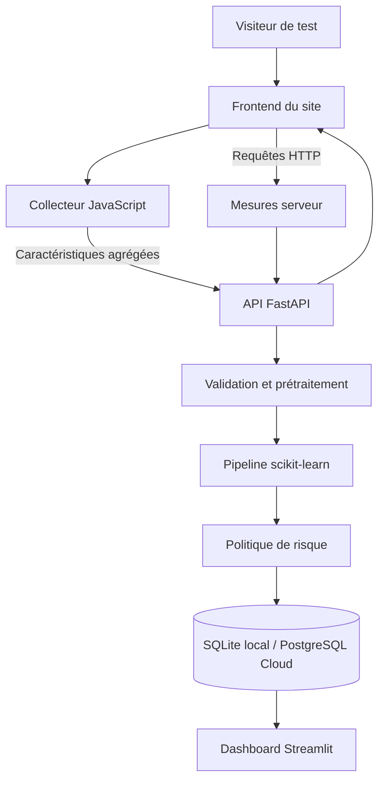

# Architecture proposée

## 1. Vue générale

Le système utilise une architecture client-serveur modulaire. Le MVP doit fonctionner sur une seule machine avant tout déploiement Cloud.

## 2. Composants

### Frontend — `frontend/`

Responsabilité : fournir les pages et les interactions de test. Il ne décide pas si un visiteur est un bot.

### Collecteur — `collector/`

Responsabilité : observer les événements autorisés, calculer des caractéristiques agrégées et envoyer une fenêtre de données. Le collecteur ne doit pas enregistrer le texte saisi.

### API — `api/`

Responsabilité :
- valider les requêtes avec Pydantic ;
- vérifier les identifiants de session ;
- recevoir les caractéristiques navigateur ;
- utiliser les mesures de requêtes serveur ;
- charger le pipeline ML ;
- renvoyer une classe et un niveau de risque ;
- enregistrer les résultats nécessaires.

### Données — `data/`

Responsabilité : documenter les sources, préparer les données et produire des jeux reproductibles. Les données personnelles brutes ne doivent pas être ajoutées au dépôt.

### Modèles — `models/`

Responsabilité : entraîner, comparer et exporter les pipelines. Le prétraitement doit être inclus dans le pipeline exporté pour garder le même traitement en entraînement et en inférence.

### Dashboard — `dashboard/`

Responsabilité : présenter les sessions, les résultats, les alertes et les métriques. Le dashboard ne doit pas être la source d'autorité pour les décisions de sécurité.

### Tests — `tests/`

Responsabilité : tests unitaires, tests de contrat et tests d'intégration.

### Infrastructure — `infra/`

Responsabilité : Docker, variables d'environnement d'exemple et configuration de déploiement.

## 3. Flux de données

1. Le navigateur ouvre une session de test.
2. Le serveur crée un identifiant de session pseudonyme.
3. Le collecteur calcule des caractéristiques pour une fenêtre de temps.
4. Le navigateur envoie les caractéristiques au backend.
5. Le backend valide les données et calcule les caractéristiques de requêtes.
6. Le pipeline ML produit une prédiction.
7. La politique de risque choisit une action de démonstration.
8. Le backend stocke le résultat et le dashboard l'affiche.

## 4. Décision de risque

Le modèle fournit une prédiction et, si le modèle le permet, un score. Le moteur de décision applique ensuite une politique séparée.

États proposés :
- `ALLOW` : risque faible.
- `CHALLENGE` : vérification supplémentaire.
- `RESTRICT` : action sensible limitée dans le scénario de démonstration.
- `INSUFFICIENT_DATA` : données insuffisantes pour une conclusion.

Les seuils doivent être choisis sur les données de validation. Ne pas présenter une sortie brute de modèle comme une probabilité calibrée.

## 5. Choix de conception

- Monolithe modulaire pour réduire le coût d'intégration.
- Traitement ML hors ligne ; inférence dans l'API.
- Agrégation navigateur avant transmission.
- Logs serveur pour compléter les signaux client.
- SQLite en local ; PostgreSQL si le déploiement Cloud le nécessite.
- Pas de microservices dans le MVP.

## 6. Décisions encore ouvertes

- Fenêtre d'observation.
- Schéma final des caractéristiques.
- Fréquence d'envoi.
- Choix final de la base Cloud.
- Format et taille de l'artefact ML.
- Politique de conservation.
