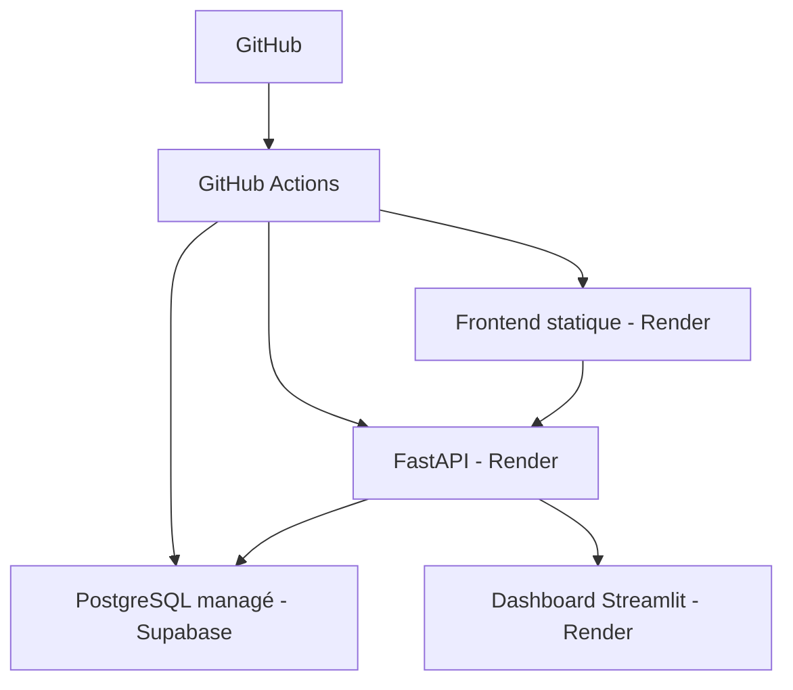

# Plan Cloud — démonstration facultative

## 1. Pourquoi utiliser le Cloud ?

Le Cloud peut rendre le site et le dashboard accessibles pour une démonstration à distance. Il peut aussi héberger l'API et une base de données partagée.

Le Cloud n'est pas nécessaire pour entraîner les modèles. Le premier entraînement doit être exécuté en local.

## 2. Architecture Cloud proposée

Le diagramme montre une option cible. Il ne signifie pas que les services sont déjà créés.

## 3. Services possibles

### Render

- Frontend : Render Static Site.
- API : Render Web Service.
- Dashboard : autre Web Service, si nécessaire.

Documentation :
- https://render.com/docs/static-sites
- https://render.com/docs/deploy-fastapi
- https://render.com/docs/free

Les offres gratuites ont des limites. Les services web gratuits peuvent s'arrêter après 15 minutes sans activité et prendre du temps pour redémarrer. Les services gratuits peuvent être redémarrés. Le PostgreSQL gratuit Render expire après 30 jours et ne fournit pas de sauvegardes. Vérifier les conditions avant usage.

### Supabase

Supabase peut fournir PostgreSQL managé.

Documentation : https://supabase.com/pricing

Le plan gratuit a des limites, dont une base de données de 500 MB et la mise en pause d'un projet après une période d'inactivité. Il ne faut pas le traiter comme une base de production.

## 4. Plan recommandé pour dix jours

### Étape A — Local d'abord

- Faire fonctionner le frontend.
- Faire fonctionner l'API.
- Faire fonctionner le modèle.
- Faire fonctionner le dashboard.
- Utiliser SQLite pour les tests locaux.

### Étape B — Démonstration Cloud

Si le MVP local est stable :
1. Déployer le frontend comme site statique.
2. Déployer l'API comme service web.
3. Configurer HTTPS et les variables d'environnement.
4. Ajouter PostgreSQL managé uniquement si une base partagée est nécessaire.
5. Déployer le dashboard si le temps le permet.
6. Tester les URL, les erreurs réseau et les redémarrages.

## 5. Garde-fous

- Aucun service payant sans accord explicite de l'équipe.
- Configurer des alertes ou limites de dépenses si disponibles.
- Ne pas stocker de données personnelles brutes.
- Ne pas utiliser de données réelles sans revue de confidentialité.
- Ne pas mettre de secret dans GitHub.
- Ne pas exposer une route de prédiction sans validation et protection.
- Ne pas utiliser le plan gratuit comme hébergement de production.

## 6. Décision recommandée

Le Cloud est une extension facultative du MVP. La démonstration locale reste obligatoire. Yahya coordonne le déploiement, mais chaque propriétaire de composant doit fournir une application testée et documentée.

La sélection finale du fournisseur dépendra des comptes disponibles, des limites gratuites au moment du déploiement et de l'approbation de l'équipe.
