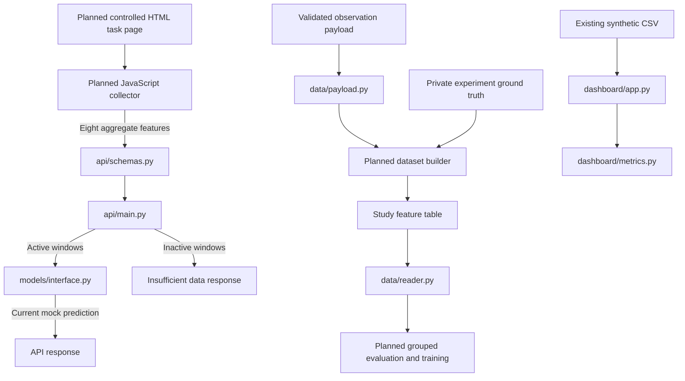

# Code components and their role in the study

This guide follows an observation from the test page through validation, prediction, dataset preparation, and analysis. File and function names use `inline code` formatting. Extracts use language-specific syntax highlighting. The [scientific protocol](SCIENTIFIC_PROTOCOL.md) defines the experiment and evaluation equations, while the [API contract](API_CONTRACT.md) describes the browser payload.

## How the components connect



The dataset builder, browser collector, and scientific evaluation runner require implementation. The current API handles requests in memory, and the dashboard reads the synthetic CSV. The diagram identifies the connections needed to complete the experiment.

## Browser tasks and event collection

**`frontend/`** is the intended home of the controlled HTML/CSS tasks. Its role is to provide the same content and task conditions for volunteers and automated browsers. The directory currently contains planning documentation. See the [frontend overview](../frontend/README.md).

**`collector/`** is the intended home of the JavaScript event collector and aggregation logic. It will observe approved mouse, click, and scroll events within each task window and send the eight aggregate features. Event delivery must be verified for every automation strategy. The directory currently contains planning documentation. See the [collector overview](../collector/README.md).

## API validation and response

**`BrowserFeatures` and `Observation` in `api/schemas.py`** define the accepted browser payload. They enforce field names, numeric bounds, required keys, schema version, and timestamp requirements. This validation protects downstream components from malformed input. It does not establish experimental ground truth. See the [schema source](../api/schemas.py).

```python
mouse_speed_mean_px_s: Measurement | None
click_count: Count
```

These declarations illustrate two distinct measurements. The mean speed key is required and accepts `None` when a statistic is unavailable. A click count must be a nonnegative integer. The schema also rejects additional fields, which keeps the observation aligned with the shared contract.

**`receive_observation()` in `api/main.py`** is the entry point for `POST /v1/observations`. FastAPI validates the submitted JSON against `Observation` before calling this function. The function checks for activity, prepares the model input, and returns the prediction, model version, and quality status. See the [endpoint source](../api/main.py).

```python
has_activity = (
    features.click_count > 0
    or features.scroll_event_count > 0
    or features.mouse_distance_px > 0
)
```

This existing rule controls whether the endpoint calls the prediction interface. A window with no detected activity produces an insufficient-data response. The rule is a quality check and must be accounted for when reporting coverage.

## Prediction interface

**`SessionFeatures`, `PredictInput`, `PredictOutput`, and `predict()` in `models/interface.py`** define how the API communicates with a prediction component. `FEATURE_ORDER` reuses the dataset's feature order, helping training and inference agree on the meaning of each column. See the [model interface](../models/interface.py).

```python
MODEL_VERSION = "mock-v0"
```

```python
return PredictOutput(
    prediction="HUMAN",
    model_version=MODEL_VERSION,
)
```

The current implementation returns a fixed HUMAN class whenever it is called. This enables integration testing. Model training, preprocessing, threshold selection, and held-out performance measurement are still required for the scientific study. The future prediction pipeline must use the same feature definitions and ordering as the training data.

## Dataset preparation and grouping

**`payload_to_row()` in `data/payload.py`** flattens `browser_features` into a table row and retains `session_id` and `window_id`. It checks the set of feature names. The dataset builder must supply `participant_id`, `label`, and `bot_config` from the experiment manifest. See the [payload conversion code](../data/payload.py).

```python
row = {"session_id": payload["session_id"], "window_id": payload["window_id"]}
row.update({c: features[c] for c in FEATURE_COLUMNS})
```

Retaining these IDs allows the builder to associate measurements with their ground truth and keep related windows together. The function expects an already validated observation. Dataset metadata uses lowercase `human` and `bot`, while the API prediction interface uses uppercase `HUMAN` and `BOT`. The evaluation pipeline must explicitly map these representations to the same classes.

**`FEATURE_COLUMNS`, `validate_columns()`, and `read_features()` in `data/reader.py`** define and check the shared CSV layout. The reader verifies column names, column order, and recognized non-null labels. It loads the data for downstream analysis and the dashboard. Additional dataset-quality checks are needed for missing labels, numeric validity, duplicate observations, and complete experiment metadata. See the [dataset reader](../data/reader.py).

**`split_by_participant()` in `data/split.py`** creates a seeded train/validation/test partition using `participant_id` within each label. It checks that a session belongs to one participant and that a participant has one label. This helper supports grouped development experiments. The scientific protocol's five leave-one-participant-out folds and held-out bot configurations require additional evaluation logic. In particular, this helper does not group by `bot_config` or bot execution ID. See the [split implementation](../data/split.py).

The existing CSV metadata columns include `participant_id`, `session_id`, `window_id`, `label`, and `bot_config`. Keep bot execution IDs in the private manifest and join them for split validation. Any addition to the shared CSV format requires a coordinated schema and test update.

**`data/synthetic_features.csv`** supplies development examples for the data reader and dashboard. Scientific results require the consented human observations and controlled bot runs described in the protocol. See the [synthetic dataset](../data/synthetic_features.csv).

## Dashboard and descriptive summaries

**`dashboard/app.py`** loads the synthetic CSV, provides label filters, and displays counts, average feature values, a scatter plot, and the observation table. Its role is to make the dataset inspectable during development. The displayed relationships are illustrative synthetic-data patterns. See the [dashboard application](../dashboard/app.py).

**`summarize()` and `average_by_label()` in `dashboard/metrics.py`** calculate dataset summaries for those views. `bot_share` is the percentage of rows labeled bot in the current filtered dataset. FPR, FNR, precision, recall, and F1 require paired ground-truth labels and held-out predictions, which this module currently does not compute. See the [summary functions](../dashboard/metrics.py).

```python
"bot_share": (df["label"] == "bot").mean() * 100
```

This expression measures the dataset's class composition. Reporting that composition helps interpret future evaluation results, particularly precision.

## Provisional keyboard validation

**`api/keyboard.py`** implements `POST /v1/keyboard-observations`. `KeyboardFeatures` checks aggregate timing statistics, `KeyboardQuality` records collection quality, and `KeyboardObservation` checks consistency between those parts. `KeyboardRoute` returns a fixed validation-error response so rejected values are not echoed. The endpoint acknowledges valid aggregate payloads in memory. See the [keyboard source](../api/keyboard.py).

This provisional endpoint supports review of the Python collector's format and units. Compatibility with the collector still requires verification. The eight-feature browser study uses its own observation contract. See the [keyboard prototype documentation](KEYBOARD_OBSERVATION_PROTOTYPE.md).

## Tests, dependencies, and automation

| Code area | Role in project verification |
| --- | --- |
| `tests/test_observations.py` and `tests/test_api_prediction_integration.py` | Check browser observation validation, activity handling, and the API-to-model connection. |
| `tests/test_interface.py` | Check the model input/output interface and current placeholder behavior. |
| `tests/test_payload.py` and `tests/test_features_columns.py` | Check payload conversion and agreement on dataset feature columns. |
| `tests/test_split.py` | Check the existing participant-based partition helper. |
| `tests/test_keyboard_observations.py` | Check the provisional keyboard endpoint and validation rules. |
| `tests/test_dashboard_metrics.py` | Check descriptive dashboard calculations. |
| `tests/test_smoke.py` | Provide a basic test-run sanity check. |
| `tests/fixtures/` | Supply synthetic observation examples for repeatable checks. |

The [test directory](../tests/) contains these checks. Run the existing suite from the repository root after installing the project dependencies.

```shell
python -m pytest -q
```

**`requirements.txt`** lists the Python dependencies shared by the API, data processing, modeling, dashboard, and tests. **`.github/workflows/ci.yml`** installs those dependencies and runs the tests for pull requests and pushes to `main`. The workflow provides automated integration feedback during review. See the [dependencies](../requirements.txt) and [CI workflow](../.github/workflows/ci.yml).

**`infra/`** currently contains deployment planning documentation. It describes the intended infrastructure work for a later demonstration. See the [infrastructure overview](../infra/README.md).

The [architecture document](ARCHITECTURE.md) presents the broader proposed system. Use this guide with the current source code to identify implemented components and the remaining work for the controlled browser experiment.
