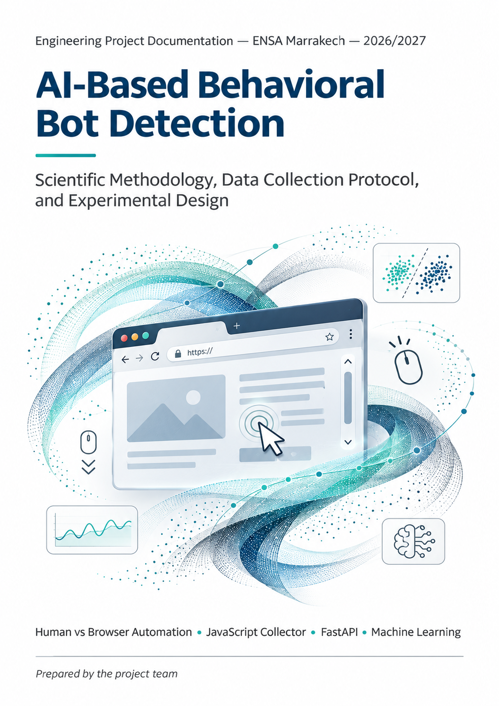

# Scientific protocol for behavioral bot detection

## Research question and scope

Under controlled browsing conditions, how well can eight mouse, click, and scroll measurements distinguish manual sessions from JavaScript-enabled browser automation? The primary hypothesis is that the measurements improve on simple baselines when both the volunteer and the automation configuration are unseen. A secondary analysis examines which tasks and configurations account for errors. Report results even if the hypotheses are unsupported.

**HUMAN** means a consenting team member manually performs a task. **BOT** means Playwright or Selenium performs the same task in a JavaScript-enabled browser on the team's test site. The study covers those volunteers, tasks, devices, and automation configurations. HTTP-only clients, general web traffic, malicious intent, identity verification, and automated access decisions are outside the study scope.

## Shared environment and tasks

Use a controlled HTML/CSS page and an in-page JavaScript collector. The page displays the task instructions, starts and stops collection, and computes the same eight aggregates for both classes. The MVP uses no Chrome extension. Use the same content, layout, task targets, timing rules, collector build, and feature-extraction code across classes. Match browser versions and viewport sizes where feasible. Log relevant environment differences in the private experiment manifest and report them as potential confounders.

| Task | Instructions for both classes | Signals in context |
| --- | --- | --- |
| Select targets | Click a short sequence of marked targets in the displayed order. | Pointer movement and inter-click timing |
| Locate an item | Scroll a fixed list to find and select a named entry. | Scrolling and a target click |
| Browse a catalog | Open a named card, return to the catalog, then select a second card. Use in-page panels so collection continues across actions. | Pointer movement, clicks, and scrolling during navigation |

Assign one task per session and propose one fixed, non-overlapping 30-second observation window per session. Start timing when the task becomes active after the collector is ready. Record early completion and retain the full window under the same rules for both classes. Record interruptions, inactive windows, incomplete tasks, and failed submissions with predefined reason codes. Track attempted, accepted, unusable, and repeated sessions separately. Counterbalance task order where feasible and reset page state between runs.

## Collection and ground truth

Recruit the five team members as consenting volunteers. Start with two sessions per person per task, for **30 planned human sessions** (5 × 3 × 2). Use the pilot to verify task comparability, event delivery, payload validation, missingness, and the manifest. If feasible, expand to ten sessions per person per task, for **150 planned human sessions total** (5 × 3 × 10). Count pilot sessions toward that total only if the approved protocol and collector remain compatible. If the protocol changes materially, report the pilot separately. More repetitions improve coverage of the tasks while the number of independent volunteers remains five.

Run controlled Playwright or Selenium sessions on the test page. Include multiple task-execution strategies, such as element-directed interaction and browser input actions, with distinct, versioned configurations. Use comparable task coverage and plan enough independent configurations to reserve some for testing. In pilot runs, confirm that the page's actual listeners observe the expected movement, click, and scroll events for each strategy and task, and that the resulting features reach the API. A completed browser command alone is insufficient evidence of collection. Log delivered event counts and payload validation during this check. Preserve genuine inactivity as an observation and log instrumentation failures separately so collector failures do not become evidence of class.

Assign ground truth from the experiment manifest at run creation. Record pseudonymous participant ID for human sessions, configuration ID and execution ID for automation, and session/window IDs for both. Also record task, collector version, protocol version, and quality outcome. Join labels to observations offline by session and window IDs. Predictions, event counts, and browser properties play no role in assigning labels. Keep the manifest fields out of the model input.

## Browser observation contract

Submit aggregates to FastAPI via `POST /v1/observations` with `schema_version: "1.0"`, pseudonymous `session_id` and `window_id`, a timezone-aware `window_started_at`, positive integer `window_duration_ms` (30000 for the proposed full window), and `collector_version`. The eight required keys in `browser_features` are defined by the [API contract](API_CONTRACT.md) and [validation schema](../api/schemas.py).

| Field | Measurement for the window |
| --- | --- |
| `mouse_distance_px` | Sum of distances between successive pointer positions in CSS pixels |
| `mouse_speed_mean_px_s` | Mean speed across valid pointer segments in CSS pixels per second |
| `mouse_speed_std_px_s` | Standard deviation of valid segment speeds in CSS pixels per second |
| `direction_change_count` | Number of direction changes under a fixed angle and minimum-movement rule |
| `click_count` | Count of observed click events |
| `click_interval_mean_ms` | Mean interval between successive clicks in milliseconds |
| `scroll_event_count` | Count of observed scroll events on the designated surface |
| `scroll_distance_px` | Sum of absolute vertical scroll-position changes in CSS pixels |

Freeze the aggregation rules before full collection, including sample timing, direction-change thresholds, the standard-deviation convention, and scroll surface. Use finite nonnegative measurements and nonnegative integer counts. Emit zero for observed absence in counts and distances. Include the mean speed, speed standard deviation, and mean click interval keys with JSON `null` when the corresponding statistic lacks enough observations. Confirm the payload against the repository's [example fixture](../tests/fixtures/observation_valid.json).

The endpoint currently returns `HUMAN` with model version `mock-v0` for windows with activity. For windows with no activity under its current quality check, it returns `prediction: null` and `data_quality: "INSUFFICIENT"`. The [implementation](../api/main.py) and [mock model interface](../models/interface.py) exercise integration only. A trained pipeline and measured results are future deliverables.

The Python mouse/keyboard collector requires explicit interoperability review. Its collection scope, output names, time units, and window semantics may differ from the browser collector. Review its source and a synthetic aggregate JSON example before proposing any adapter. The separate [keyboard prototype](KEYBOARD_OBSERVATION_PROTOTYPE.md) validates a provisional payload through `POST /v1/keyboard-observations` without calling the model. Keyboard timings stay outside the eight-feature study, as do server request features.

## Evaluation and uncertainty

Use the window as the prediction unit and retain session IDs throughout. With one window per session the window and session counts coincide. If the design later includes multiple windows per session, keep them together and predefine how any session-level prediction is aggregated.

1. Use five outer leave-one-participant-out folds. In each fold, test on all eligible sessions of one volunteer and train using the other four. Keep every window of a session together.
2. Preassign automation configurations to disjoint outer test blocks where counts permit. Keep all related executions and their windows together. Exclude the entire relevant test block from training and validation in its fold. If there are too few independent configurations for five bot blocks, reserve a fixed set for a separate generalization evaluation and score it once with a frozen pipeline. Report the design actually used and the independent group counts.
3. Fit imputation, scaling, model selection, and decision thresholds using training data only. Use grouped internal validation if the group counts support it. Otherwise predefine a small set of fixed settings. Keep held-out scores out of all tuning.
4. Compare a training-majority predictor and an activity-count baseline with regularized logistic regression using the eight features. Consider a random forest as an exploratory comparison if the data support it. Use identical test groups across comparisons. Keep synthetic fixtures for integration tests.

Treat BOT as the positive class. Report confusion counts, false positive rate (FP / (FP + TN)), false negative rate (FN / (FN + TP)), precision (TP / (TP + FP)), recall (TP / (TP + FN)), and F1 (the harmonic mean of precision and recall). Flag zero-denominator metrics as undefined, and give denominators, class balance, and decision threshold. Report pooled out-of-fold counts and variation across participants, bot configurations, and tasks. Report abstentions or unusable observations with their denominators and give coverage alongside classification metrics so excluded windows remain visible.

Show per-group results and ranges as descriptive uncertainty. If enough independent groups are available, use a grouped bootstrap over participants and automation configurations, preserving their nested sessions, and identify the interval method. With only five volunteers, any interval is exploratory. The team-only sample, repeated tasks, and controlled automation limit external validity.

## Consent, minimization, and reproducibility

Explain the tasks, signals, storage, access, retention, and withdrawal process before obtaining voluntary consent. Collect only within the visible task window on the study page. Compute aggregates locally and discard transient coordinates and event timing after aggregation. Exclude keystrokes, typed text, credentials, form values, unrelated browsing, and device fingerprints. Restrict access to pseudonymous aggregates and keep any consent-to-ID mapping separately with narrower access. Agree a deletion date and withdrawal cutoff before collection. Keep participant records and raw traces out of GitHub. See the [privacy guidance](SECURITY_AND_PRIVACY.md).

Version the task page, collector, feature definitions, automation configurations, environment, split procedure, and evaluation settings. Record data revisions and quality exclusions in a private experiment manifest. Use synthetic payloads for examples and tests. Publish only approved aggregate results. The [dataset and evaluation notes](DATASETS_AND_EVALUATION.md) cover broader research directions.

## GitHub workflow

Create one branch per component or documentation change and open a pull request against `main`. Push work in progress early so teammates can review interfaces using synthetic fixtures. Ask the collector and API owners to review units, null handling, and payload compatibility. Ask the data and modeling owners to review label joins, grouping, and split checks. Use integration review to verify the page, API, and model wiring. Include the rationale, test evidence, and any protocol deviations in each PR. Merge through review and checks. See [team roles and workflow](TEAM_AND_WORKFLOW.md) and the [repository README](../README.md).
